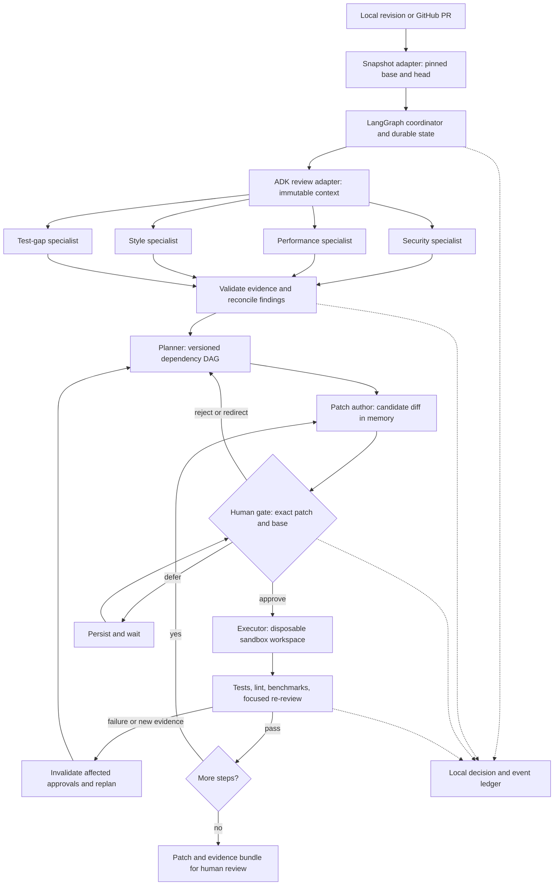

# Review Ledger — Track 5 architecture

Status: original design proposal, 26 October 2026. No implementation or runtime compatibility test has been completed. Scope: Python codebase or GitHub PR review and small, dependency-aware refactoring patches. All behavior below is proposed unless marked **verified documentation**. Submission requirements derive from [shared requirements](CAPSTONE-REQUIREMENTS.md), whose [assignment source](https://docs.google.com/document/d/1FPDr1uDqUHj9IdHaRiUd_yI9lq4REdOScZRjcE7vP5k/edit) was transcribed there; this design does not claim an independent reading of the source document.

Reading budget: this main design targets 2–4 typeset pages; [technical reflection](TECHNICAL-REFLECTION.md) targets another 1–2 pages. Markdown has no fixed page count. Confirm whether reflection counts within the architecture total; consolidate and typeset before submission. This file is at the dedicated project root. If the instructor expects a standalone repository root, export this directory as that repository without moving or editing the shared project root.

## 1. Outcome and system boundary

Review Ledger explains a change through evidence, proposes an ordered repair plan, and produces reviewable patches only after a human authorizes each step. Four independent perspectives prevent a single reviewer from silently conflating security, speed, conventions, and test adequacy. The human can reject, redirect, defer, or stop at every step.

MVP input is a pinned local Git revision (whole-codebase review), a GitHub PR head plus its base, or a unified diff plus a pinned base repository. Materialize a supplied diff only in a disposable intake snapshot; reject a mismatched base. A bare diff without source context supports explicitly partial read-only findings, not executable refactoring. Whole-codebase mode uses the revision as its initial parent tree and does not require a synthetic PR. Limit intake to 30 Python source files / 20,000 lines; oversize inputs require a human-selected subset with an explicit coverage warning. Output is a findings ledger, versioned dependency DAG, individual unified diffs, test evidence, and a final review bundle. The tool never merges, deploys, pushes, or automatically alters the user's checkout. Patch generation is in-memory; applying a patch occurs only in a disposable workspace after approval. Returned patches still require normal human review before adoption.

## 2. Architecture and flow

LangGraph owns the authoritative lifecycle, DAG, approvals and checkpoint. ADK owns bounded specialist reasoning, never lifecycle transitions. A custom Python adapter passes an immutable snapshot and collects independently named outputs; neither framework is assumed to share sessions or provide a built-in bridge. Application code validates, normalizes and deterministically joins outputs by agent ID. Only independent analysis runs concurrently; change execution is serial.

The planner and patch author are also ADK reasoning agents, called separately from LangGraph nodes through the same adapter. The synthesis barrier waits for a terminal result from each specialist, then the planner reconciles duplicates and conflicts while preserving provenance. A deterministic join alone is not the claimed synthesis agent. See [implementation contract](IMPLEMENTATION-CONTRACT.md) for intake, identity, gating and replay rules.

## 3. Agents and contracts

| Agent | Goal and responsibility | Input → output | Boundary |
|---|---|---|---|
| Security reviewer | Identify injection, unsafe deserialization, access-control and secret exposure risks | Snapshot + policy → evidence-linked findings and safe remediation constraints | Read-only; no exploit execution or credentials |
| Performance reviewer | Identify repeated work and scaling costs; distinguish hypotheses from measurements | Snapshot + benchmark evidence → complexity claims, benchmark proposals, findings | Never claim measured speedups without runs |
| Style reviewer | Check repository conventions, naming and maintainability | Snapshot + pinned lint configuration → findings and affected symbols | No large cosmetic rewrite; distinguish preference from rule |
| Test-gap reviewer | Identify untested behavior and propose characterization tests | Diff + existing tests + coverage evidence → missing cases and acceptance criteria | Coverage alone is not correctness |
| Synthesis/planning agent | Reconcile contradictions and decompose fixes into dependency-aware goals | Validated findings → plan revision, alternatives and DAG | Cannot approve its plan; deterministic validator rejects cycles |
| Patch author | Produce one minimal candidate satisfying one ready step | Approved planning constraints + current snapshot → unified diff and test intent | No filesystem write tools or direct execution |

The deterministic coordinator, executor and evidence validator are components, not additional claimed reasoning agents. A planning discussion or plan acceptance never substitutes for approval of each exact refactoring patch. Every source or test edit, including lint fixes and recovery patches, follows this gate; there are no automatic fix commands. In-memory proposals may be generated before approval, but applying any edit requires approval first.

Versioned JSON contracts, validated at every adapter boundary:

- `ReviewRequest`: run_id, snapshot_hash, base_sha, head_sha, file_manifest_hash, scope, policy_version, budget.
- `Finding`: id, agent_id, category, severity, confidence, file/symbol/line_span at snapshot, evidence_ids, rationale_summary, assumption_ids, suggested_action. Evidence must resolve to that snapshot; unsupported claims are quarantined.
- `PlanStep`: id, plan_version, goal, finding_ids, depends_on, read_set, write_set, risk, preconditions, acceptance_checks, alternatives, expected_outcome.
- `PatchCandidate`: step_id, parent_tree_hash, patch_sha256, changed_paths, diff_artifact, rationale_summary, validation_commands.
- `Approval`: approval_id, authenticated_actor, decision, timestamp, run_id, plan_version, step_id, parent_tree_hash, patch_sha256, policy_version, comment. Single use; rejection, expiration or mismatch blocks execution.
- `ToolResult`: invocation_id, tool/version, input_hash, status, exit_code, duration, stdout/stderr artifact hashes, retry_count, limitations.

## 4. State, approval and recovery lifecycle

State contains snapshot identity, per-specialist status/results, evidence references, DAG/version, current step, candidate, approvals, applied-step manifest, workspace identity, budgets and terminal reason. Large source and log artifacts live outside checkpoints and are referenced by hash.

`INTAKE → SNAPSHOT → ANALYZE → SYNTHESIZE → PLAN → PROPOSE → WAIT_APPROVAL → APPLY → VERIFY → REPLAN or NEXT → COMPLETE`. Additional terminal states: `CANCELLED`, `BLOCKED`, `PARTIAL_REVIEW`. Rejection returns to planning or ends; deferral persists without applying. A redirected candidate is a new candidate and needs fresh approval. Before applying, verify dependencies passed, parent tree matches, scope is unchanged, and approval matches every bound field. After any accepted step, every subsequent candidate is regenerated against its resulting tree. Any plan revision invalidates all pending approvals in the MVP. An external head change requires re-snapshot, affected re-review and fresh approvals.

**Verified documentation:** LangGraph supports `interrupt()` with a checkpointer and stable `thread_id`, resumed with `Command(resume=...)` [interrupts documentation](https://docs.langchain.com/oss/python/langgraph/interrupts). Proposed implementation uses a persistent SQLite checkpointer for a single-user prototype; RAM-only checkpoints do not satisfy restart recovery [persistence documentation](https://docs.langchain.com/oss/python/langgraph/persistence). Keep the interrupt node free of mutation: resumed nodes may restart from their beginning. Approval authentication and binding are application responsibilities.

A write-ahead operation record is keyed by run/step/patch/base. On crash, compare workspace tree and operation status before retrying; reconcile an already applied matching diff instead of applying twice. If the result is ambiguous, discard that disposable workspace and reconstruct from the last verified tree. No claim of automatic exactly-once execution. Failed patches never enter the accepted chain; retain failure artifacts and discard the failed workspace.

## 5. Adaptive dependency planning

Goal hierarchy: preserve behavior → address evidenced high-risk findings → establish missing behavioral tests → refactor → demonstrate acceptance. Planner proposes edges for shared symbols, required characterization tests, import/call dependencies, and overlapping writes. Static evidence proposes dependencies; it does not prove semantic independence. Validator enforces acyclicity, valid references, bounded scope and executable acceptance checks. Conflicting findings remain visible and may require human direction.

Example: S1 adds a missing empty-input characterization test; S2 replaces a quadratic lookup and depends on S1; S3 renames the affected helper and depends on S2. If S1 reveals undocumented exception semantics, mark S2's assumption false, pause S2/S3, revise their goals and re-review affected code. Present both preserving exception behavior and deliberately changing the contract; require human direction for the latter. Previously approved descendants cannot run. Unaffected findings remain cached only when their code and policy hashes still match.

Rank ready steps by evidenced severity, prerequisite value, estimated effort and risk; expose the score inputs. Replan on failed tests, unavailable evidence, reviewer contradiction, scope change, rejected patch or budget exhaustion. Limit one schema repair per agent, two transient tool retries, two revisions per step and a configurable run budget; exhaustion pauses for human direction rather than looping.

## 6. Integrations, isolation and tracing

1. **GitHub REST + Git snapshot:** ingest PR metadata/files with a read-only token and resolve complete content at pinned SHAs. Verify that the fetched head still matches; handle pagination and incomplete diffs explicitly. Local snapshot input remains available during outages. **Verified documentation:** GitHub exposes pull-request REST resources [official reference](https://docs.github.com/en/rest/pulls/pulls). Endpoint limits and authentication details must be confirmed in the implementation spike.
2. **Local analysis/test tools:** integrate pytest, coverage, Ruff and a controlled benchmark harness through an allowlisted runner. Record tool versions, baseline and candidate results. No model-provided shell command is executed verbatim. These are external tool integrations independent of the model API and GitHub.
3. **Optional observability:** LangSmith export after privacy review; local JSONL and hashed artifacts are mandatory and sufficient for offline inspectability. LangSmith does not count toward the two required frameworks.

Each execution uses a detached disposable Git workspace at the verified parent tree. **Verified documentation:** Git worktrees support additional working trees [official manual](https://git-scm.com/docs/git-worktree); a worktree is not a security sandbox. Run untrusted repository tests in a separate container isolation boundary with no secrets, no network by default, CPU/memory/time limits, restricted mounts, and no host Git metadata writes. The host executor exports sanitized source into that boundary and imports only allowlisted results. Reject path traversal, symlink escapes, binary patches and edits outside the selected scope. Treat repository text as untrusted data, never privileged instructions. Dependency installation is pinned and separate from test execution.

Every event has event_id, run_id, parent_event_id, agent/component, UTC timestamp, snapshot/plan/step IDs and outcome. Decision records include concise rationale, alternatives, evidence IDs, assumptions and uncertainty, not hidden chain-of-thought. A finding links to code; a plan links to findings; an approval links to a patch; validation links to tool artifacts. Redact secrets before model calls and exports; store local source privately with configurable retention. Trace/export failure falls back locally; inability to persist the local approval/operation ledger blocks mutation.

| Failure | Recovery and visible outcome |
|---|---|
| GitHub unavailable/rate limited | Bounded backoff; use pinned cached/local snapshot with provenance, otherwise block intake |
| Specialist times out or returns invalid schema | One repair then mark missing; show partial analysis; MVP blocks all changes until all four reviews complete; human may retry, narrow and rerun all reviews, or end read-only |
| Tool missing or baseline already failing | Mark acceptance unavailable or baseline failure; do not report a clean pass; replan or stop |
| Tests fail after application | Retain evidence, discard workspace, invalidate dependent candidates, propose narrower fix |
| Process restarts at approval/apply | Restore checkpoint, validate actor/input bindings, reconcile operation ledger and tree |

## 7. Framework decision and feasibility boundary

Select **Google ADK + LangGraph with HITL**, satisfying two mandatory technologies. **Verified documentation:** ADK documents concurrent `ParallelAgent` workflows [official guide](https://adk.dev/agents/workflow-agents/parallel-agents/) and structured agent output with model-dependent tool/schema caveats [agent reference](https://adk.dev/agents/llm-agents/). Proposal: collect tool evidence before schema-only review calls, externally validate all outputs, and avoid concurrent writes to shared ADK state. The exact Python/model/checkpointer version combination remains unverified until the spike pins and exercises it.

ADK supplies specialist boundaries and reusable model/tool interaction; LangGraph supplies explicit transitions, persisted waits and conditional replanning. Cost: duplicated state concepts and an adapter to maintain. ADK-only would reduce integration overhead but would not satisfy two-framework requirements alone. LangGraph-only has the same compliance issue. CrewAI plus LangGraph is a credible alternative, but adds a different delegation abstraction without a demonstrated advantage for fixed specialists. n8n could route notifications yet is unnecessary for this local review loop. A2A becomes useful for independently deployed reviewers; a network protocol adds avoidable failure modes in the MVP. See [technical reflection](TECHNICAL-REFLECTION.md) for deeper tradeoffs.

## 8. Review and delivery

[Evaluation and scenarios](EVALUATION.md) define reproducible known-smell fixtures, fault injections, metrics and release gates. [Delivery plan](DELIVERY-PLAN.md) maps every requirement to components and evidence, sets milestones and provides a 9:30 demo including a failure. No runtime, corpus, metrics or recording is claimed complete.

Unresolved: instructor's architecture/reflection page counting, actual Canvas deadline (assignment says end of Week 5 despite Week 6 title), submission of two tracks versus the instruction to select one, model availability/cost, container availability on the demo host, persistent-checkpointer compatibility and final repository destination. These do not block this design. Source attribution for adapted code and the student's ability to explain every line remain mandatory.

